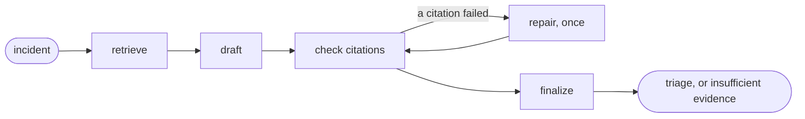

# incident-triage-agent

[](https://github.com/realjoegz/incident-triage-agent/actions/workflows/ci.yml)

An incident triage agent in Python on FastAPI, LangGraph, PostgreSQL with pgvector, and MCP. It takes an incident (an alert, a ticket, a log excerpt), retrieves similar past incidents and runbook sections, and returns a root-cause category with the likely cause, the next diagnostic step and quoted evidence. When the documents do not cover the incident, it says so. Two things are unusual. Code, not the prompt, decides whether a cause is allowed out: it needs a quote that is word for word in a retrieved document. And every number below is measured on a labelled set, and CI fails when a change makes one worse. CI needs no API key for that: it replays recorded model answers through the current code.

## Results

Five variants answered 50 labelled incidents three times each. The corpus documents the cause of 38 of them. It does not document the other 12, and for those the right answer is to abstain. [docs/evaluation.md](docs/evaluation.md) defines each column.

<!-- results:start -->
| Variant | Recall@5 | Root-cause accuracy | Abstains without evidence | Citation faithfulness | Cost per incident | Latency p50 / p95 |
|---|---|---|---|---|---|---|
| No retrieval, Haiku 5.5 | n/a | 43% | 83% | n/a | $0.0003 | 2.4 s / 3.7 s |
| Vector, Haiku 5.5 | 0.89 | 60% | 100% | 95% | $0.0007 | 3.5 s / 5.8 s |
| Full text, Haiku 5.5 | 0.79 | 58% | 100% | 91% | $0.0007 | 3.5 s / 6.1 s |
| Hybrid, Haiku 5.5 | 0.93 | 67% | 100% | 91% | $0.0007 | 3.5 s / 6.5 s |
| Hybrid, Sonnet 5.5 | 0.93 | 79% | 100% | 97% | $0.0103 | 2.8 s / 6.5 s |
<!-- results:end -->

## Run it locally

You need Docker with Compose, `curl` and `jq`, and ports 8088 and 54329 free on the loopback address.

```
TRIAGE_LLM=replay docker compose up --build --detach --wait
scripts/demo.sh
```

The first command starts PostgreSQL and the API. With `TRIAGE_LLM=replay` the API answers the 50 labelled incidents from the recorded responses of the evaluation and needs no key. The second command searches the corpus, triages one incident that the corpus documents and one that it does not, and checks both answers.

To call the model, export `ANTHROPIC_API_KEY` and start the stack without `TRIAGE_LLM`. `docker compose down --volumes` removes the stack.

## How it works



- **Retrieve.** One query is built from the incident. A vector search and a full-text search run in PostgreSQL, and their rankings are fused by reciprocal rank into five documents.
- **Draft.** The model sees the incident and the five documents and returns JSON that the API constrains to a schema: a decision, a category, the cause, citations and the next step.
- **Check.** Code verifies each citation: the document must be one of the five, and the quote must be in it word for word.
- **Repair.** If a citation fails, the model gets one more call with the list of what failed.
- **Finalize.** Citations that still fail are dropped. An answer that names a cause and has no valid citation left becomes "insufficient evidence".

The agent reaches the corpus only through two MCP tools, `search_evidence` and `get_document`. `triage mcp` serves the same tools over stdio to any MCP client.

## How it is measured

- **Labels by construction.** Each incident is rendered from a fault in a catalogue, and the fault's category is the label. No model assigned a label. [docs/data.md](docs/data.md) describes the set.
- **Code grades what code can.** Recall, accuracy, abstention and cost are computed from the labels and from the token counts that the API reported.
- **A judge model grades one question.** Whether the cited documents state the cause that an answer gives is put to Claude Opus 5.5, which is neither model under test.
- **The harness is tested first.** A stand-in model that knows the answer key must score exactly the hit rate of the search, one that always abstains must score zero, and one that invents its quotes must be stopped by the citation check.
- **A run can be repeated without a key.** The vectors of the corpus and the incidents are committed, and every model response is recorded under a hash of its request.

## What CI fails on

`triage eval gate` runs on every push and calls no model. It fails when:

- **Retrieval got worse.** It is measured again and compared with [`eval/baseline.json`](eval/baseline.json).
- **The results are stale.** The evaluation is replayed, and the current code builds a prompt that has no recorded answer. A changed prompt or a changed search ends here, and the paid run has to be repeated.
- **The results were edited.** The replay must compute the committed files byte for byte.
- **A metric fell below its baseline** by more than its tolerance. Accepting that takes a new baseline in the same commit, where a reviewer sees it.
- **The table above is not the rendered one.**

## Design decisions

- [A fixed pipeline](docs/design.md#8-what-was-rejected), not a tool-choosing agent: with one search per incident there is nothing for the model to decide, and a fixed graph is what makes the citation guarantee a property of the code.
- [Quotes checked by string comparison](docs/design.md#5-the-citation-check), not the API's citation feature: that feature cannot be combined with schema-constrained output.
- [Exact vector search](docs/design.md#3-retrieval), not an HNSW index: at 80 documents an index adds approximation to the thing being measured.
- [Committed embeddings](docs/design.md#7-reproducibility), not recomputed ones: ONNX floats differ between CPUs, and rank fusion turns a swapped neighbour into a different prompt.
- [No fallback model, no cache, own retries](docs/design.md#6-the-model-interface): a row that says Haiku holds only Haiku answers, and its cost and latency do not depend on what ran before.

## What it does not do

- **No scale.** The corpus is 80 short documents and nothing is chunked.
- **No real data.** Every incident and document is synthetic, written by one author, and all 50 incidents were visible while the prompts were written.
- **No second search.** The agent cannot follow a lead from the first five documents.
- **No check of claims at run time.** A quote is verified; whether it supports the cause is measured in the evaluation, not enforced.
- **No hostile-text test and no redaction.** The prompt marks incident text as data, and that is all.
- **No authentication on the API.**

[docs/design.md](docs/design.md#9-limits) and [docs/evaluation.md](docs/evaluation.md#7-how-far-to-trust-this) have the rest.

## Repository

- `src/triage`: the agent, retrieval, the MCP server, the API, the model interface and the evaluation.
- `data`: the fault catalogue and what is rendered from it.
- `eval`: the recorded responses, the results and the baseline.
- `docs`: the documents, indexed in [docs/README.md](docs/README.md).

To read the code, start with [`graph.py`](src/triage/agent/graph.py) (the pipeline), [`retrieval.py`](src/triage/retrieval.py) (the three searches, as SQL), [`runner.py`](src/triage/evaluation/runner.py) (a run and a replay) and [`test_evaluation.py`](tests/test_evaluation.py) (the harness against stand-in models).

## Build and test

```
docker compose up --detach --wait db
uv sync
uv run pytest
uv run triage eval gate --readme README.md
```

You need [uv](https://docs.astral.sh/uv/) and Docker. `uv run triage eval replay` rebuilds the results from the recordings. `uv run triage eval run --max-usd 8` runs the evaluation against the API and pays only for calls that have no recording.

## License

Apache License 2.0. See [LICENSE](LICENSE).
