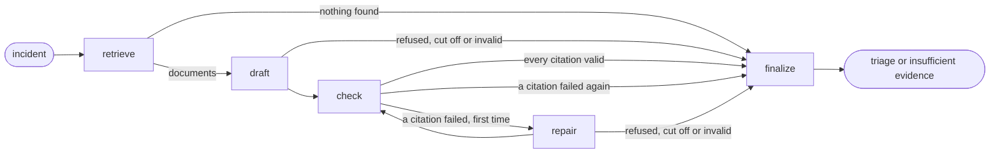

# Design

## 1. What the agent promises

Given an incident (an alert, a ticket, a log excerpt, or any mix of the three), the agent returns one of two answers:

- **A triage.** A root-cause category from a closed set of ten, the likely cause in one or two sentences, the next diagnostic step, and at least one citation. A citation is the id of a document the agent retrieved and a quote that is in that document, word for word.
- **Insufficient evidence.** No cause, no category, no citation, and the first thing to check.

The second answer is not a failure mode. An on-call engineer who is told a wrong cause loses time on it while the incident goes on, so the agent is built to prefer "the documents do not cover this" over a guess.

One part of the promise is enforced by code and not by the prompt: with retrieval on, no triage leaves the agent without a citation that passed the check in [section 5](#5-the-citation-check).

## 2. The pipeline

The agent is a LangGraph state graph with five nodes ([`graph.py`](../src/triage/agent/graph.py)).

- **retrieve** builds one query from the incident and asks the search tool for the five closest documents.
- **draft** is the first model call. The model sees the incident and the five documents and returns the answer as JSON that the API constrains to a schema.
- **check** is code. It verifies each citation of the draft.
- **repair** is the second and last model call. It happens only when a citation failed, and its prompt is the first prompt plus the draft and the list of what failed.
- **finalize** is code. It decides what leaves the agent.

The model is called once per incident in the usual case and twice at most. Which node runs next is never the model's decision.

## 3. Retrieval

Documents live in one PostgreSQL table with a `vector(384)` column and a generated `tsvector` column ([`schema.sql`](../src/triage/schema.sql)). Three searches run on it ([`retrieval.py`](../src/triage/retrieval.py)):

- **Vector.** Cosine distance to the embedding of the query, from `bge-small-en-v1.5`, which runs locally.
- **Full text.** The lexemes of the query joined with OR and ranked by `ts_rank`. The query is the incident itself and runs to dozens of words, so AND would match nothing.
- **Hybrid.** The top 20 of each, fused by reciprocal rank with the constant 60.

Three details matter for measurement:

- **The query.** The alert and the ticket go in as they are. From the logs only the messages go in, each once: timestamps, levels and host names are stripped.
- **Ties.** Every ranking is ordered by score and then by document id. Reciprocal rank fusion produces exact ties often, and without the second key their order would be whatever PostgreSQL returned.
- **No vector index.** The search is an exact scan. At 80 rows an HNSW index would add approximation to the thing being measured and save nothing.

## 4. The MCP boundary

The agent holds no retriever and no database connection. It calls one tool on an MCP server ([`mcp_server.py`](../src/triage/mcp_server.py)), `search_evidence`. The server also offers `get_document`, which the agent does not use. Inside the API and the evaluation the client is connected to the server object in the same process. `triage mcp` serves the same object over stdio, and a test starts it as a subprocess and searches through it.

What this buys is one definition of "the evidence the agent can reach", usable by another client. What it costs is a serialisation round trip per search, which is inside the search latency reported in [evaluation.md](evaluation.md).

## 5. The citation check

For each citation of a draft ([`citations.py`](../src/triage/agent/citations.py)):

1. The document id must be one of the five that were retrieved.
2. The quote must be at least 20 characters.
3. The quote must be a substring of the document's title and body, after whitespace is collapsed, case is folded and curly quotation marks are straightened.

If any citation fails, or a draft names a cause and cites nothing, the model gets one repair. After the repair, failed citations are dropped. If none is left, the answer becomes "insufficient evidence" with the reason recorded.

This check is about existence. It guarantees that a quote is real and comes from a document the model was shown. Whether the document supports the stated cause is a different question, which the evaluation puts to a judge model.

## 6. The model interface

The agent depends on one method: a request with a system prompt, a user prompt and an output schema goes in, and text with a stop reason and token counts comes out ([`llm/base.py`](../src/triage/llm/base.py)). There are three implementations:

- **`ClaudeLLM`** calls the Claude API through the official SDK.
- **`ReplayLLM`** answers from recorded responses and never calls anything.
- **`RecordingLLM`** answers from a recording when there is one, and otherwise pays for a call and records it.

`ClaudeLLM` makes four choices for the sake of measurement:

- **Its own retry loop.** The SDK's retries are off, so the latency of a response is that of the attempt that succeeded and the number of attempts is known.
- **No fallback model.** The API can rerun a declined request on another model. A row of the results table that says Haiku must not contain answers from something else, so a refusal comes back as a refusal and is counted.
- **No prompt caching.** A cached prefix would make the cost of one variant depend on what ran before it.
- **A check of the serving model.** A response whose `model` is not the one requested is an error, not an answer.

## 7. Reproducibility

Two mechanisms make the evaluation repeatable without an API key.

**The embedding snapshot.** ONNX Runtime does not produce bit-identical floats on every CPU. A difference in the sixth decimal can swap two neighbours in the vector ranking, rank fusion can turn that into a different top five, and a different top five is a different prompt. So the vectors of the 80 documents and the 50 incidents are computed once and committed ([`data/embeddings.jsonl`](../data/embeddings.jsonl)). The evaluation searches with those vectors only, and a test recomputes every one and fails if the model or the text has moved away from the file.

**Recorded responses.** Every model response of a paid run is stored under a SHA-256 of its request: model, effort, token limit, system prompt, user prompt and output schema. CI runs the whole evaluation again with `ReplayLLM`. The agent retrieves, builds its prompts and checks citations with the current code, and a prompt that has no recording stops the run. That makes "the committed results are stale" a failure that CI can detect, not a thing someone has to remember.

## 8. What was rejected

- **A tool-choosing agent.** The model could decide when to search and what for. It would add calls and variance, and at one search per incident there is nothing for it to decide. A fixed pipeline is also what makes the citation guarantee a property of the code.
- **The Citations feature of the API.** It returns character ranges that the API itself verifies. It cannot be combined with schema-constrained output, and the agent needs the schema more.
- **A similarity threshold for abstaining.** Cosine scores of unrelated incidents on the same service overlap with those of related ones. The decision is left to the model, and the check bounds what it can claim.
- **LangChain's model wrappers.** The nodes call the Anthropic SDK through the interface above, so recording, replay and cost accounting see every request.
- **A hosted embedding API.** It would be a second paid dependency, and the test that recomputes the committed vectors would need its key in CI.

## 9. Limits

- **The corpus is 80 short documents.** Nothing is chunked, and nothing here says how retrieval behaves at ten thousand documents or with an approximate index.
- **Full-text ranking has no inverse document frequency.** PostgreSQL's `ts_rank` counts a service name as much as a rare error code.
- **One search per incident.** The agent cannot follow a lead: it does not search again with what the first documents told it.
- **The category set is closed.** A cause outside the ten categories can only be answered with "insufficient evidence".
- **Quotes are checked, claims are not.** At run time nothing verifies that a cited document supports the stated cause. The evaluation measures how often it does.
- **No defence against hostile text beyond the prompt.** The incident and the documents are marked as data in the prompt, and that is all. There is no test set of injected instructions.
- **No redaction.** Incident text is sent to the model as it arrives.
- **The API has no authentication and no rate limit.** A request field is capped at 20,000 characters, which bounds the cost of one call and nothing else.
